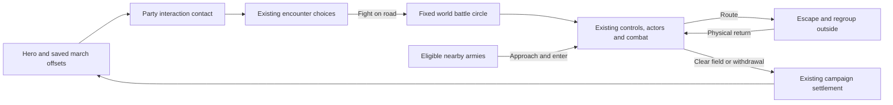

# World-map battles

Campaign pace tuning (2026-10-24): WORLD_SCALE.travel is 2 for campaign moveStep calls. World combat and its marching reinforcements explicitly retain the base WORLD_SCALE.move, so this travel increase does not speed up battle.

Status: playable campaign version, with physical travel formations, individual pathfinding and actual-position battle entry, 2026-10-24. Enabled by `WORLD_BATTLE.on` in `prototype/js/battle/worldbattle.js`. Travel soldiers use the battle unit sprites, equipment and distance-driven walking poses at the same world scale, with faction cloth colors and individual troop races. Campaign leaders use their battle character sprites, including hero and companion equipment, at marching scale; picking and banner heights follow the displayed sprites. Leaders draw directly from full-resolution battle assets at the world transform; the reduced cached cell is used only for picking and banner measurements. Battle-side palettes remain unchanged; combat keeps the existing unit sprites, actors, orders, morale and campaign settlement.

## Army size, monsters and battle start

Player armies start with three group slots, including the hero and companions. Each trained Leadership level above two unlocks another, to ten total slots. Troop groups hold at most ten soldiers, including their wounded. Recruitment quotes and additions, splits, merges and group transfers enforce these limits. NPC count-based armies split into ten-soldier groups. Existing oversized armies retain their soldiers; additions remain constrained. Headcount capacity has a floor matching the unlocked troop-group capacity, while existing headcount bonuses remain.

The core radius is the base inner radius plus twice the square root of army headcount. The outer radius includes that core, padding and the largest formation footprint; small armies no longer inherit the old fixed 38-pixel minimum. Saved formation placements remain clamped to the actual footprint bounds.

Monster packs use Party rosters, march figures, contact circles and the same physical world-battle handoff. Split beast AI packs retain distinct marchers. Participating campaign figures are hidden during combat; same-kind monster packs nearby can reinforce, with casualties applied to their source pack. Flying mythic marchers ignore ground obstacles as their world movement does.

World-battle screen shake uses 20% of the regular battle amplitude (SHAKE.world), keeping charge feedback subtle; reduced-motion preferences still disable it. Double-clicking or double-tapping a campaign destination starts the existing Hurry action; the next normal travel click cancels Hurry. A double-click on a party approaches it at Hurry pace. Exhaustion and normal supply costs still apply.

Settings → Pause when battle starts defaults to On. Its `bpause` preference pauses combat initialization independently of deployment and persists across sessions. Off starts combat running; Space resumes a paused battle.

## Travel and contact

The hero anchors the player's army. Army → Roster → March formation opens a drag editor, with group buttons and arrow controls for touch and keyboard use. The hero stays at zero. Army cards, march group buttons and march circles share the deployable roster numbering (1 through 9, then 0); wounded companions do not consume a number. The editor offers Line, Column, Loose and cavalry Wedge per troop group, with incompatible choices disabled. Column is a line one soldier abreast. Apply stores offsets under `P.army.march`, keyed by persistent group ID, and saves form/files on the persistent troop group; Back discards both edits. Travel and world-battle setup use those same group settings. Draft footprints resize the outer ring and keep placements out of the interaction band. Each group circle centers actual soldier sprites at a fixed 2x source-pixel size in CSS pixels, facing the front arrow; its group number sits on the upper edge. Preview spacing and circles grow to accommodate these silhouettes instead of shrinking characters to fit. The canvas uses the full left pane and a responsive height; device-pixel backing preserves sharpness, and pointer coordinates use the current canvas geometry. Missing offsets use a ring round the hero. Wounded and away companions do not march as fit groups. Existing saves need no new world save piece.

The inner ring marks the core. Groups can stand anywhere inside the outer ring, including inside the core. Their entire formation footprint must fit; the interaction band outside it accepts no placement. The outer radius grows when a group's existing frontage/formation needs more room. Travel offsets rotate toward the army's movement heading at a bounded angular speed, including while it finishes a turn. Each visible military party has a faction-colored outer circle and a faint dashed interaction ring; your camp retains its army circle.

Each travel soldier owns a persistent runtime position and follows a goal from its group's saved offset and formation slots. Soldiers route around water, peaks, closed crossings and building feet; open ferries allow only their designated corridor. Narrow passages compress the ranks, with local avoidance and unique reachable goals. Soldiers reform on open ground and after the hero stops. The hero retains normal travel control; followers move at the army's ordinary marching pace. Nearby military NPC armies use the same system. Drawing and pause never advance the soldiers.

`MarchGround` builds a bounded local 4-pixel grid and reuses the shared A* and flood helpers. Routes are cached, with at most six oldest-first path requests per army per update. Grids refresh after two world seconds, a route-version change or movement beyond their bounds. Armies update within sight range plus 180 world pixels. Runtime positions and routes reset on load, a new session or a large scripted relocation; saved group offsets are unchanged and need no migration.

Campaign leaders keep moving while followers turn and reform. They never wait for formation completion or stragglers; an unreachable follower cannot immobilize the army. Followers retain ordinary marching speed without the former catch-up multiplier. Terrain-aware standing goals, cliffs and ferry-crossing restrictions remain. Travel experience follows actual movement.

Blocked formation slots resolve to the nearest free slot in the individual marcher's reachable ground, with personal spacing. World cliff edges are copied into the local navigation grid. Final slots must be standing ground: ferry channels remain traversable but cannot become parked formation positions. Reachable alternatives remain stable while stopped, rather than continually pursuing the ideal water/building slot.

Party contact uses both armies' outer radii plus their interaction bands. It opens the existing encounter window. Holdings and other non-party objects retain their normal interaction reach. Fight enters world combat for bands, lords, patrols, caravans, monsters and battles the player joins. Tournaments, assaults, raids, camps, caves and the Battle Lab retain their existing setup. Autoresolve remains available.

## Fixed battle area

The initial circle encloses the two starting parties' formation circles and their actual marching soldiers. Its centre and radius stay fixed. Hero movement and reinforcements cannot move or enlarge it. A small apron outside the boundary allows escape and regrouping. Tracked soldiers enter combat at their actual travel positions; surviving soldiers resume travel where combat leaves them.

The battle uses local combat coordinates with a reversible world transform. Combat draws over the live world renderer, with its surrounding terrain, buildings and minimap. The active combat boundary grants no visibility. The normal campaign vision range is centred on the combat hero, using the same remembered-land and mist renderer as travel. There are no additional battle-only unit sight bubbles. Only terrain actually seen is added to campaign memory and the minimap; unexplored buildings and enemies remain hidden even inside the battle circle. Land outside current unit sight returns to remembered fog. Tactical terrain concealment remains bypassed; normal sight distance still applies. Physical obstacles and projectile line of sight still apply. The native world canvas, map zoom and camera position stay unchanged when dialogue becomes combat; no arena fit, map switch or battle loading screen occurs. Campaign figures of participating armies are suppressed while their combat actors occupy those same world coordinates. The movement/sight grid samples this same window of `WM`: terrain kinds, climates, elevation, roads, water, cliff edges and building footprints. It does not generate or mirror an arena. This first grid is coarse: it follows world tiles, rather than every painted tree or rock pixel. Specialized generated bridge/ambush layouts are replaced by the actual world terrain on these road battles.

Combat sprites and formation spacing are three times their original size, including fallen bodies, selection bounds and line previews. March footprints account for the wider ranks. Moving combat figures snap to native display pixels rather than whole world pixels; their walk poses follow distance travelled. Group markers retain a stable screen size at the world canvas scale. The world camera can still pan; there is no separate battle zoom or automatic fit. Ordinary route grids are masked to the circle, with separate unmasked grids for escape into the apron. Normal selection, move, dragged line, attack, abilities, AI control, zoom, pause and touch commands remain the battle engine's. Group destinations, waypoints and ordinary soldiers are constrained to the circle. Withdrawal uses the normal disengagement and stamina rules, with a circular exit. Saving during combat remains unavailable.

## Reinforcements and routing

Eligible lords, patrols, companions' parties and bandit bands can approach during combat. Existing relation/help rules choose a side; bands can help another band. Reinforcements enter from their world position when they physically reach the circle. Each tracked rear marcher must cross the boundary before its combat actor activates; its goal moves inside the fixed circle without teleporting it. Allies listed in the encounter also approach, rather than appearing immediately. Their existing actors activate once; later arrivals receive unique actor/group IDs and retain source-army and source-group identity. Troop casualties go back to those sources. Armies that never arrive receive no battle spoils or capture/relationship outcomes.

Routing soldiers may cross the boundary. Each chooses a fixed, reachable exit on the unmasked terrain grid, follows its path around rock/cliffs, and leaves as soon as it crosses the boundary. It may wait in the apron to regroup, then physically return while allies continue fighting. Health, ammunition and spent fatigue survive the trip. The group recovers enough morale to accept orders again. Each group gets one return by default; another rout leaves permanently, preventing endless escape/rejoin cycles. Explicit withdrawal does not cause an automatic return. When either side has no fighters left, victory or defeat is final; the normal result banner lasts two speed-adjusted seconds before campaign settlement. There is no clear-field delay in which a fully routed side can rally and restart the fight. Regrouping and approaching reinforcements cannot reopen a decided outcome. After 30 combat seconds without damage, a battle where neither side has a legal route or an unobstructed attack in range ends as Disengaged. This does not award victory, charge a retreat renown/gold penalty, or force a rematch. Connected armies that the player orders to hold are not timed out. The surviving hero's actual position becomes the travel anchor afterward.

Campaign calendar time and unrelated world simulation remain paused during combat, as in the previous battle mode. World battles inherit and share `G.speed` (1×, 2×, 4×, 8×), including the buttons, bracket keys and speed retained on return to travel. Movement uses the campaign pace and `WORLD_SCALE.move`, converted to local combat coordinates; hero and troops use that same clock. Scaled updates are split into steps of at most 1/60 second before pace conversion. Hero hit-stop and charge slow motion do not freeze or slow every army in world combat. The arriving armies use their normal `partySpeed`, converted from combat coordinates to world distance on this clock. Simultaneous independent tactical battles and a continuously advancing campaign are later work.

## Owners and tuning

| File | Responsibility |
| --- | --- |
| `prototype/js/world/march.js` | `marchRows`, footprint/radius, direction, mock drawing; `MarchGround` routes and shared building feet; `MarchArmy` physical soldiers, formation goals and avoidance |
| `prototype/js/battle/worldbattle.js` | `WorldBattleArea` coordinates, terrain, boundary, actual-position handoff, arrivals, regrouping and cleanup; `WorldBattleSetup` |
| `prototype/js/core/session.js` | Clears the player's runtime march state on reset |
| `prototype/js/ui/march.js` | Formation editor, draft/apply/back and touch dragging |
| `prototype/js/battle/setup.js` | Chooses world or existing battle setup |
| `prototype/js/battle/battlecontrol.js` | Normal order destinations constrained immediately, including while paused |
| `prototype/js/battle/battle.js` | Shared-speed substeps, matching hero/troop time, world-area tick, bounds and terminal results |
| `prototype/js/battle/morale.js` | Routing escape hook and circular withdrawal exit |
| `prototype/js/battle/formations.js`, `commands.js` | Scaled formation slots, dragged-line preview and sprite picking |
| `prototype/js/battle/terrain.js` | World combat uses normal campaign sight distance while bypassing tactical concealment, preserving collision and projectile sight lines |
| `prototype/js/ui/ui.js` | Shared world battle speed buttons and bracket steps |
| `prototype/js/gfx/sprites.js`, `vfx.js` | Distance-based walk poses and matching fallen-body scale |
| `prototype/js/battle/resolution.js` | World-area cleanup before existing campaign settlement |
| `prototype/js/gfx/render.js`, `battle/camera.js` | World ground/boundary and minimap inside the existing battle renderer |
| `prototype/js/world/brains.js`, `world/world.js` | Party contact range |
| `prototype/js/world/parties.js`, `gfx/render.js` | Small travel formations |

`WORLD_BATTLE` owns the combat numbers: scale 6 combat pixels per world pixel; inner base radius 8, minimum outer radius 14, interaction band 6, escape apron 22; reinforcement search 220 past the boundary (approach uses normal party speed); regroup wait 7 combat seconds; sprite/formation scale 3 and maximum scaled real-time step 1/60 second; battle radius at least the larger starting sight range plus 4 times the square root of the combined starting fighter count (including leaders), and large enough to enclose both march footprints; at most 1 regrouped return per group and terrain-stalemate quiet interval 30. Formation footprint can grow the outer radius.

`MARCH_MOVE` in `world/march.js` owns travel tuning: grid cell 4, padding 48, chunk 64, repath delay 0.45 seconds, refresh 2 world seconds, catch-up multiplier 1, turn speed 1.5 radians/second, personal gap 2.4, active margin 180, path-query budget 6 and relocation reset distance 160. The `march formations` frame system runs at order 145, before arrival. No new save piece is required.

## Verification

`marchpaths` checks independent legal positions, bridges and ferries, building detours, turns and reversals, reforming, bounded path requests, recruits/losses, pause, session reset, NPC armies and actual-position battle handoff. `visual/marchpaths` supplies desktop and landscape-phone bridge, reformed-rank and 150-soldier scenes.

`worldbattle` covers formation bounds/drafts, contact, world coordinates, orders while paused, escape/return without restored vitals, dynamic arrivals, source casualties, withdrawal, non-arrival cleanup, saving/loading and heading. `worldbattleedges` checks circles, the shared world viewport/minimap, final routing, circular route grids and neutral disengagement. `worldbattleissues` covers real damage-to-victory/defeat settlement, full rout, a radial exit blocked by rock, collision-safe escape, formation spacing, native pixel movement, sprite scale, shared speed, matching hero/troop timing, pause and unit-sight fog clipping without circle-wide exploration. `worldbattleterrain` runs on untouched generated roads, forests and hills. `worldbattleplay` runs complete campaign combat with physics, sight, AI, an approaching ally and normal results. `visual/worldbattle` supplies desktop and landscape phone travel, editor, combat and reinforcement scenes. Older fixtures explicitly disable `WORLD_BATTLE`, preserving their isolated battle behavior and fingerprints.

World sprite counts (2026-10-25): Party.draw adds a separate leader figure only for a character added to the troop roster in combat (hero, lord, companion, or a chieftain absent from the troop list). Ordinary parties and patrols use their existing troop figures; a chief already in the troop list is drawn once in that formation. Banners remain at the army anchor. Monsters keep their existing per-beast drawing. The troop roster, movement and combat creation are unchanged. Tests: marchcounts compares actual render calls with real battle actors; marchlooks checks appearance (22 checks passed).
World-to-battle appearance (2026-10-25): WorldBattleArea.place carries each matched marcher's variant and source army colour into combat. Separate leaders keep variant 0, matching their travel figure and horse coat. World actors use actorSprite for body, animation, warmup, ghosts and fallen sprites; unitLook applies the same cloth to held weapons and sidearms. Team markers and health bars retain side colours; separate tactical battles retain their original palettes. Combat sprite warmup runs again after appearance handoff. Tests: marchappearance compares pre-battle pixels with actual battle actors, mounted leaders, hero, weapons and return to travel; marchlooks checks existing appearance (16 checks passed).
Normal world fog in combat (2026-10-25): built. Battle uses the same campaign vision range, remembered-land renderer and mist/dimming as travel, centred on the combat hero. World range uses Scouting, equipment and the ground at that actual position. Battle-specific fog cut-outs and additional per-unit sight bubbles are removed. The yellow dashed circle retains its larger sight/count-based size and limits movement only; it never changes sight or exploration. Unexplored terrain stays hidden. Enemy visibility and combat-effect clipping use that same normal world range. Tests: battleworldfog (7), battlesizesight (15), including a pixel-identical fog comparison between combat and travel.

Worker world battles (2026-10-25): EstateWorker draws its recruitKind battle sprite at world scale with stable worker variant and holding cloth while WORLD_BATTLE is enabled. Villagers resistance uses WorldBattleSetup on the current map; workers start at their existing positions and their ordinary figures are suppressed during combat. Matching actors retain worker race, equipment, variant and colour; estate guards use the same world battle. Survivors keep combat positions, dead workers cannot reappear after a loss, and population/replacement costs are charged once. Existing victory loot, conduct, guard settlement and manual worker interactions remain in use. No save piece is added. Tests: workerworldbattle (12), conduct (89), guards (7).
Travel pivots and animal bands (2026-10-25): leaderless armies use one existing formation member as their moving pivot. A lone creature stands exactly at its band position, without orbiting an offset or requesting follower paths. Multi-unit formations centre their pivot group around that member; followers retain terrain-aware routes and bounded speed. Recruitment/losses retain a surviving pivot. Heroes, lords, companions and separately counted chiefs keep their existing anchors. A chief already in the troop list becomes the pivot. Monster packs and wild herds show a small cached paw marker above their existing leader, with group count where applicable; wild herds use their first animal as centre. Travel rings use that same centre. After combat, a surviving pivot keeps the band's position, or another existing survivor is promoted; the fixed yellow battle boundary never moves. No fighter or save piece is added. Tests: marchpivots (18), marchpaths (22), marchcounts (14).
Reinforcement allegiance (2026-10-25): worker/villager resistance and faction-owned party encounters now identify the defending realm. forceRealm reads the real source army before a copied force record. reinforceSide gives faction allegiance priority over friendship, neutral help rolls and stale helper lists; same-realm troops defend their own side, allied defenders support that realm, and ambiguous allied conflicts stay out. Personal companion parties remain loyal to the player. Field-battle membership is preserved where one realm appears on both sides. Initial helpers are aligned before previews and spawning; WorldBattleArea.teamFor uses the same decision for late arrivals. Unaffiliated outlaw bands only reinforce matching band kinds. Existing peace/war, neutral chance, range and helper-cap rules still apply when no faction decision resolves the side. No new diplomacy penalty is applied just to choose a side. Tests: reinforceallegiance (21 passed); existing reinforce has the same 30 pass/13 fail result with this change enabled and disabled.
Order previews (2026-10-25): dragged formation dots and facing arrows scale with world battle sprites; destination dots use the same minimum size, including the straight-line fallback. Order paths, attack rings and formation ghosts draw beneath characters and obstacles. Visibility and orders are unchanged.

Routing and missiles (2026-10-25): escape targets need only clear the boundary by two combat pixels. Regrouping units select the nearest reachable entry at least 18 combat pixels inside and walk a cached route on the escape terrain grid, preserving health, fatigue and the one-return limit. Physical missiles and their shadows scale with WORLD_BATTLE.sprite; trajectories, damage and tactical rendering are unchanged. Tests: worldretreat (7), worldbattleedges (18).

March guides and reach (2026-10-25): unit previews use unfilled dashed hulls around actual formation slots, with the same three-world-pixel clearance as marchExtent. Fixed-size character art stays anchored to those slots. Dragging, formation changes and Apply keep the complete footprint inside the army placement circle. The selected ranged group shows a shared frontage-aware firing fan or circular coverage for all-round shooters; the editor uses base stats in world distance and terrain can modify live range. Canvas framing reserves room for range without changing sprite size. Battle range layers include native world-map scale and keep their edge readable. Tests: marchrange (10), formationfacing (16).

March formation dragging (2026-10-25): right-drag a frontage line for the selected group, or choose Draw formation for primary-pointer/touch input. Its midpoint sets placement and the left side of the drag sets facing, as in battle. Live previews use the same files calculation at world scale; wedges retain their fixed shape. Dragging keeps the complete footprint in bounds, short gestures do nothing, and pointer cancellation restores the draft. Move groups retains ordinary repositioning. Facing is saved as a relative angle in army.march, defaults to zero, rotates travel slots and carries into world-battle group heading. Hero remains the fixed anchor. Tests: marchdrag (11), marchrange (10).

Fixed editor circle (2026-10-25): March editor snapshots the allowed army radius and view extent on opening. Frontage edits and formation choices fit within that boundary rather than growing or reframing it. Unsupported fixed shapes are unavailable; an overlarge rank/file layout uses the nearest fitting file count. A fixed-size facing arrow beside every formation guide follows its relative heading, during and after dragging. This fixes editing behavior; campaign army sizing still follows its existing rules. Tests: marchdrag (17), marchrange (10).

World effect sizing (2026-10-25): magic bolt cores/glows, cosmetic glow flashes, sparks/trails, embers, dust, frost, blood, ghost sprites and ground-stuck arrows use WORLD_BATTLE.sprite around their own drawing origin. Slash widths, tips and decorative offsets scale, while slash reach and slam area radii remain in combat distance. Area shockwaves, nova/explosion coverage, swirls and crack lengths preserve their radii/extent with heavier world strokes. Arrows attached to units already inherit the actor transform and are not scaled twice. Physical missile trajectories, damage, effect simulation and tactical size remain unchanged. Tests: worldeffects (19), worldretreat (7).

Merge repair (2026-10-25): drawWorld calls fogMem and drawWorldFog directly in combat and travel. WorldBattleArea has no fog wrapper. Restoring the obsolete wrapper call throws before units and fog render. Regression suites battleworldfog (7) and worldeffects (19) cover this integration.

Battle-centred zoom (2026-10-25): each successful world-battle zoom step centres the new viewport on the fixed battlefield centre, clamped at world edges. Wheel and keyboard share camZoom; battle touch pinch now steps through the world zoom levels with the same centre and resets its threshold after each step. Manual pan, including two-finger pan between steps, remains available. Battle start and movement boundary are unchanged. Tests: battlezoom (7).

Projectile hits and concealment (2026-10-25): world missiles sweep their movement segment against body boxes scaled by WORLD_BATTLE.sprite, with mounted dimensions distinct from infantry and the first intersected enemy taking the hit. Arcing collision retains a low-height interval; high and wide shots still miss. Flat world shots launch at scaled chest height and aim at the target body. Tactical collision remains unchanged. World battles now run BattleSight terrain concealment, combined with the existing radial world sight limit; woods, rises/buildings, close detection and attack-reveal memory apply to AI, picking and drawing. Close detection uses sprite scale. After actual world placement, sight and last-seen state are rebuilt before presentation, so initial temporary setup positions cannot reveal hidden units. Normal world fog, exploration and vision range remain unchanged. This supersedes the earlier radial-only actor visibility shortcut. Tests: worldhitvisibility (14), concealment (30).

Bystander reaction (2026-10-25): BattleBystanders owns local nonparticipant avoidance while world combat runs. Nearby uncommitted armies, outdoor workers, wild herds, monsters, caravans, refugees, ships and mobile road encounters retreat beyond the fixed battlefield plus a clearance margin (army footprint included). Reinforcement decisions run first; participants and committed reinforcements are excluded. Cached local routes respect terrain/buildings, with water-only ship navigation and a flight grid for flying monsters. If the safe perimeter is unreachable, an entity seeks the furthest reachable refuge instead. Safe bystanders stop; existing work/travel goals are untouched and normal campaign time remains paused. Completion releases local state and restores worker animation flags. Buildings, sites, traces, penned livestock, indoor workers and fixed encounter scenes are not displaced. Tunables: WORLD_BATTLE.avoid (28 world pixels), avoidScan (1 combat-time unit). Tests: battlebystanders (12), reinforceallegiance (21).

Local bandit defence (2026-10-25): eligible nearby lords and patrols that are not hostile to the player reliably join against outlaw bands on their faction’s currently owned land. The same local-duty reason applies before battle and to live reinforcements, bypassing neutral help rolls and fair-odds gating. In combat, territory is checked at the fixed battle centre; before combat, at the player meeting position. Faction allegiance still takes priority. Captured former homes do not grant patrols automatic local duty; off-territory help keeps existing conditional rules. Tests: localbanditdefence (10), reinforceallegiance (21).

Outdoor entity conversion (2026-10-25): caravan travel now draws its actual guard roster with MarchArmy circles/formation around the cart; the cart is an anchor/prop, not an extra fighter. Caravan marchers update in travel and local battle avoidance. When fighting, guard travel figures are suppressed and the same roster, positions, variant, type and realm cloth become battle actors. Caravan and estate primary defenders retain their real source records for casualty updates and faction appearance. Estate guard fights, outdoor camps and occupied ruins now use WorldBattleSetup alongside the previously supported outdoor encounter types. By owner choice, cave interiors, siege/raid assaults, tournaments and sandbox remain on special battlefields. Civilian interactions and abstract hunting are unchanged. Tests: outdoorworld (16), caravanparty (35).

Joining an ongoing world fight (2026-10-25): WorldBattleArea records the original Fight and every participating army, counts their fighters including leaders, and encloses all existing formation circles/spreads before fixing the boundary. Original party travel sprites/rings and the campaign fight tally are hidden during tactical combat. Existing combatants enter immediately; new helpers retain the pending reinforcement path. Joins against monsters carry the same fight identity. fightPlace relocates cached MarchArmy figures with their anchor and clears stale routes; combat placement snaps blocked starting figures to nearby open ground. Tests: joinworldfight (16), fights (18). The broader worldbattle run passed 33 checks but still reported five formation-offset/editor/save assertion failures; those assertions were left unchanged.

Group concealment and bait (2026-10-25, built): world/ambush.js MarchAmbush and TRAVEL_AMBUSH add Hold concealed / Rejoin march to each troop inspector in Army. The order anchors that group's real march formation in world coordinates, independent of hero movement and facing; open ground still exposes it. It automatically rejoins past 220 world pixels, and stale/removed group orders are discarded. Anchors are plain P.army.concealed records, absent by default. TravelAwareness maintains independent suspicion and observed-power records per observer/group; current positions, cover of all members, group footprint and capped group-size visibility determine detection. Quiet held forest groups build suspicion at half rate; moving groups at 1.35x. Known group strength lasts 8 seconds after losing sight, preventing instant knowledge erasure. Travel lords, bands, guards and monsters judge observed strength and pursue spotted groups rather than the hidden hero. No NPC-to-NPC perception or automatic scout-search orders were added.

World-battle handoff preserves actual held positions. Held groups begin with firm/cease flags and are excluded from automatic commander orders. A player order releases those flags for selected groups; ordinary BattleSight concealment, attack reveal and existing ambush charge shock handle the surprise. No teleport, extra fighters or new damage bonus. BattleSight also recognizes the exact world forest tile when coarse terrain cells fall over a forest edge. Resolution clears travel holds. Tests: travelambush; existing travelsuspicion, traveldetection, worldhitvisibility, wildhunt and aishare checks.

Compact preparation (2026-10-27, built): initial armies form around their actual meeting anchors instead of walking to the circle edges. Saved march offsets and unit formations still apply, and the sides face each other. Each army steps backward only when its forward formation needs clearance: BATTLE_MUSTER.gap is 20 world pixels and retreat is capped at 16 world pixels per army. Circle size no longer determines retreat distance. Reachable terrain fallback and the pause/Start Battle flow remain. Tests: battlemuster, battlepreparation.

Multi-army encounters (2026-10-27, built): battle/sides.js owns BattleSides and armyRelation. World encounters against moving parties, lords, patrols, caravans and monsters, and battles joined on the map, reserve at most BATTLE_JOIN.armies (8) participant slots. Reinforcement admission checks BATTLE_JOIN.fighters (300) against the whole incoming force; it waits instead of deleting or splitting soldiers. Existing initial armies remain intact. Compatible two-side battles keep their original execution path. When relationships require it, each army receives its own battle ID; friends cooperate, neutrals are not targets, and enemies fight even when both oppose the player. Realm relationships, player hostility, band kinds and monster species decide those links. Every captain controls only its own groups, and every casualty goes back to its source roster.

Normal targeting and spatial queries, missiles and area attacks, character AI, morale support, commander powers, manual attack picking and victory checks share the same hostility contract. No extra damage or movement bonus is added. An army entering walks to the existing circle; preparation and its boundary do not restart. Per-army colours, names, approach intent and the army count identify the participants. Pending forces do not earn spoils. Hunting, tournaments and fixed-site assaults keep their existing flows.

The player can withdraw independently. Their health, stamina, wounded and troop losses settle normally. Gold, renown, prisoners and monster drops count only kills made by the player army; a defeated lord is captured only when that army defeats its leader, and caravan cargo requires majority participation. Remaining hostile NPC armies resume a multi-army campaign fight at their actual positions with surviving rosters. Its sides, explicit war pairs and fractional wear are plain saved records. A party leaving does not stop the others. Existing map fights can be joined without dropping neutral participants. Tests: freeforall and freeforallplay; normal-play hunting regression huntlive. All 48 actor/attack snapshot values matched the unchanged codex commit; pre-existing assertions and fingerprints were not rerecorded.

Army relationship presentation (2026-10-27, built): BattleArmyHud in ui/battlehud.js reads BattleSides and the existing reinforcement queue. Its collapsed Armies button opens named army banners with Your army / Ally / Hostile / Neutral, participation state and the selected army’s complete relationship lists. Direction arrows describe approaching armies relative to the current view; full-force admission failures explicitly name the fighter limit. Notices persist until admission and open the corresponding relationship view. Reinforcement events announce actual entry, including neutral colours. Mobile uses the same drawer above the bottom status panel; scrolling, Escape and outside-tap dismissal preserve the existing battle orders. No combat or diplomacy changes. Tests: armyintel and mobilebattlehud.

Multi-army AI coordination (2026-10-27, built): ArmyTactics in battle/commander.js runs after each captain’s normal arm orders and before formation finishing. Infantry, shooting, cavalry, beast tactics and abilities remain the source of posture decisions. Charging/advancing AI groups choose visible, reachable hostile formations with proximity and threats to their own soldiers weighted; a four-second commitment and 45-pixel improvement threshold prevent minor target oscillation. Contact threats can interrupt immediately. An isolated charging group or a formation with half its soldiers far from their expected slots assembles briefly, with a retry cooldown and immediate defence when threatened. Automatic pursuit requires contact (30 battle pixels), lasts at most three seconds or 90 pixels, and then cools down for eight seconds. Ranged free fire can still hit a fleeing foe already in weapon range. Per-captain state remains battle-local, outside saves and fingerprints. Manual control and two-coalition battles retain their previous execution paths. Tests: armytactics and production mobile combat freeforallplay.

Mounted charge loops (2026-10-27, built): CavalryRide in battle/commander.js adds approach → charge → exit → recover to mounted melee AI wings while PHYSICS.on is enabled. It scores both sides of an arc, rejects legs that leave the field/circle or cross blocked mounted ground, and penalizes paths through nearby hostile troops. Contact is brief (0.7 seconds, 0.3 when crowded, tired or against a braced spear), then a forward peel and outer return leg create the next approach. Travel and charge have time limits; no viable arc delegates to existing tactics or local regrouping. Recovery requires 55 stamina and formation, with the existing morale recovery bound. Crossing staging, bridge defence, initial ambush rushes and ranged cavalry retain their specialized decisions. ArmyTactics leaves a cavalry wing’s active riding plan alone. AI handoff clears that plan.

PHYSICS.horse tunes curvature from speed and lateral acceleration, blends tight steering at low speed, preserves forward speed while wheeling and commits to a turn side for a target behind the mount. Arrival braking still settles a move at its ordered destination. Sprite direction and charge momentum follow the actual heading; terrainHold/physPost still enforce barriers and cut blocked speed. This intentionally changes mounted trajectories with physics on; foot movement, physics-off behavior, damage formulas and stamina pools are unchanged. No fingerprints were rerecorded. Tests: cavalryride (movement and phase flow), cavalryplay (normal commander, repeated charges, terrain and manual orders), mobile freeforallplay regression.

Cavalry under pursuit (2026-10-27, built): measured against chasing foot and cavalry (tests/cavalrychase), the loop exit gave 50–120 px of separation and later charges began 4–20 px from the foe, because the exit circled the enemy's old position and tired riders walked out. CavalryRide now breaks away: legs of CAVALRY_RIDE.out px away from the chasers' middle (up to 115° off it, least turn, no woods, marsh, edge or circle), while the riders outrun them, at a gallop down to FATIGUE.spent stamina; recovery begins with a gap (clear px) and a new charge needs runMin px of run-up. Riders as fast as their pursuers turn and meet them (a forced charge). A charging target is met within meet px; a moving target's waypoints shift with it. Measured after: run-ups 77–105 px against foot, recovery 120–220 px clear, gallop share above 75%, no standing brawls.

Hard ground (2026-10-27, built; tests/cavalryhard): spear walls (pikes, braced or shield-walled spears) are approached by the flank and never charged head on: one facing the riders and not engaged elsewhere makes them stand off balk s. Escape legs score woods and marsh down (rough), and widen to 115° along an edge. With no flank route, a straight run-up line is tried before the old tactics. Plain spear levies stay chargeable. In woods the riders may not see foot through the trees at all (existing sight), so no charge there is not a failure. Recovery still waits for stamina (rested, or restMax s and minSta), but the riders now shadow their mark while they rest (2026-10-27, the owner's choice): a spot off his flank, clear of every foe and of their walk there, re-picked only when he moves; they stand there, since walking restores no stamina. cavalryhard's crowded field now allows two riders lost (the rest spots change what they charge into). Fingerprints: unchanged on this machine against the unchanged base (both differ from the recorded values in a Linux browser).

Withdrawal controls (2026-10-27, built): the Withdraw button previews the way off the field before you commit (hover or focus; on a touch screen a first tap, which closes the orders drawer and offers Retreat now and Cancel for six seconds). Withdrawing groups keep their paths on show and are listed under the balance of power, with the men already off the field, that the battle ends for you once all are off, and, with several armies, that the rest fight on without you. The world battle's withdrawal itself was broken: men walked to the circle on the field's own ways, which end inside it, and stood there; they now follow the escape way routers use, so a full withdrawal ends the battle as a retreat. Tests: withdrawview, armyresults.

Army-by-army results (2026-10-27, built): the battle report lists every army that fought, yours first: fought, fallen, withdrew, fled, still standing, kills; then what your army earned (the campaign's actual change in gold, renown, experience and prisoners) and, after a withdrawal, the armies still on the field. Classic battles show your band, allies and the enemy. Tests: armyresults.

Mobile (2026-10-27, reviewed): at 844×390 the dock, cards and drawers fit and keep 44 px controls; the withdrawal strip keeps its key lines (the directions drop on short screens). Crowds (built): overlapping banners keep two badges; a four-army world battle step fell from about 47 ms to 14–28 ms in a headless browser (the spatial grid's reset now empties only used buckets, its nearest search goes man by man on a sparse field; morale finds members by group first), every pick unchanged. Tests: battlecrowd. Still to do: a real-device check of the world-map battle on a phone.
