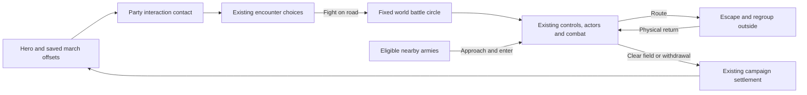

# World-map battles

Campaign pace tuning (2026-10-24): WORLD_SCALE.travel is 2 for campaign moveStep calls. World combat and its marching reinforcements explicitly retain the base WORLD_SCALE.move, so this travel increase does not speed up battle.

Status: playable campaign version, with physical travel formations, individual pathfinding and actual-position battle entry, 2026-10-24. Enabled by `WORLD_BATTLE.on` in `prototype/js/battle/worldbattle.js`. Travel soldiers use the battle unit sprites, equipment and distance-driven walking poses at the same world scale, with faction cloth colors and individual troop races. Campaign leaders use their battle character sprites, including hero and companion equipment, at marching scale; picking and banner heights follow the displayed sprites. Leaders draw directly from full-resolution battle assets at the world transform; the reduced cached cell is used only for picking and banner measurements. Battle-side palettes remain unchanged; combat keeps the existing unit sprites, actors, orders, morale and campaign settlement.

## Army size, monsters and battle start

Player armies start with three group slots, including the hero and companions. Each trained Leadership level above two unlocks another, to ten total slots. Troop groups hold at most ten soldiers, including their wounded. Recruitment quotes and additions, splits, merges and group transfers enforce these limits. NPC count-based armies split into ten-soldier groups. Existing oversized armies retain their soldiers; additions remain constrained. Headcount capacity has a floor matching the unlocked troop-group capacity, while existing headcount bonuses remain.

The core radius is the base inner radius plus twice the square root of army headcount. The outer radius includes that core, padding and the largest formation footprint; small armies no longer inherit the old fixed 38-pixel minimum. Saved formation placements remain clamped to the actual footprint bounds.

Monster packs use Party rosters, march figures, contact circles and the same physical world-battle handoff. Split beast AI packs retain distinct marchers. Participating campaign figures are hidden during combat; same-kind monster packs nearby can reinforce, with casualties applied to their source pack. Flying mythic marchers ignore ground obstacles as their world movement does.

World-battle screen shake uses 20% of the regular battle amplitude (SHAKE.world), keeping charge feedback subtle; reduced-motion preferences still disable it. Double-clicking or double-tapping a campaign destination starts the existing Hurry action; the next normal travel click cancels Hurry. A double-click on a party approaches it at Hurry pace. Exhaustion and normal supply costs still apply.

Settings → Pause when battle starts defaults to On. Its `bpause` preference pauses combat initialization independently of deployment and persists across sessions. Off starts combat running; Space resumes a paused battle.

## Travel and contact

The hero anchors the player's army. Army → Roster → March formation opens a drag editor, with group buttons and arrow controls for touch and keyboard use. The hero stays at zero. Army cards, march group buttons and march circles share the deployable roster numbering (1 through 9, then 0); wounded companions do not consume a number. The editor offers Line, Column, Loose and cavalry Wedge per troop group, with incompatible choices disabled. Column is a line one soldier abreast. Apply stores offsets under `P.army.march`, keyed by persistent group ID, and saves form/files on the persistent troop group; Back discards both edits. Travel and world-battle setup use those same group settings. Draft footprints resize the outer ring and keep placements out of the interaction band. Each group circle centers actual soldier sprites at a fixed 2x source-pixel size in CSS pixels, facing the front arrow; its group number sits on the upper edge. Preview spacing and circles grow to accommodate these silhouettes instead of shrinking characters to fit. The canvas uses the full left pane and a responsive height; device-pixel backing preserves sharpness, and pointer coordinates use the current canvas geometry. Missing offsets use a ring round the hero. Wounded and away companions do not march as fit groups. Existing saves need no new world save piece.

The inner ring marks the core. Groups can stand anywhere inside the outer ring, including inside the core. Their entire formation footprint must fit; the interaction band outside it accepts no placement. The outer radius grows when a group's existing frontage/formation needs more room. Travel offsets rotate toward the army's movement heading at a bounded angular speed, including while it finishes a turn. Each visible military party has a faction-colored outer circle and a faint dashed interaction ring; your camp retains its army circle.

Each travel soldier owns a persistent runtime position and follows a goal from its group's saved offset and formation slots. Soldiers route around water, peaks, closed crossings and building feet; open ferries allow only their designated corridor. Narrow passages compress the ranks, with local avoidance and unique reachable goals. Soldiers reform on open ground and after the hero stops. The hero retains normal travel control; followers move at the army's ordinary marching pace. Nearby military NPC armies use the same system. Drawing and pause never advance the soldiers.

`MarchGround` builds a bounded local 4-pixel grid and reuses the shared A* and flood helpers. Routes are cached, with at most six oldest-first path requests per army per update. Grids refresh after two world seconds, a route-version change or movement beyond their bounds. Armies update within sight range plus 180 world pixels. Runtime positions and routes reset on load, a new session or a large scripted relocation; saved group offsets are unchanged and need no migration.

Campaign leaders keep moving while followers turn and reform. They never wait for formation completion or stragglers; an unreachable follower cannot immobilize the army. Followers retain ordinary marching speed without the former catch-up multiplier. Terrain-aware standing goals, cliffs and ferry-crossing restrictions remain. Travel experience follows actual movement.

Blocked formation slots resolve to the nearest free slot in the individual marcher's reachable ground, with personal spacing. World cliff edges are copied into the local navigation grid. Final slots must be standing ground: ferry channels remain traversable but cannot become parked formation positions. Reachable alternatives remain stable while stopped, rather than continually pursuing the ideal water/building slot.

Party contact uses both armies' outer radii plus their interaction bands. It opens the existing encounter window. Holdings and other non-party objects retain their normal interaction reach. Fight enters world combat for bands, lords, patrols, caravans, monsters and battles the player joins. Tournaments, assaults, raids, camps, caves and the Battle Lab retain their existing setup. Autoresolve remains available.

## Fixed battle area

The initial circle encloses the two starting parties' formation circles and their actual marching soldiers. Its centre and radius stay fixed. Hero movement and reinforcements cannot move or enlarge it. A small apron outside the boundary allows escape and regrouping. Tracked soldiers enter combat at their actual travel positions; surviving soldiers resume travel where combat leaves them.

The battle uses local combat coordinates with a reversible world transform. Combat draws over the live world renderer, with its surrounding terrain, buildings and minimap. The active combat boundary grants no visibility. The normal campaign vision range is centred on the combat hero, using the same remembered-land and mist renderer as travel. There are no additional battle-only unit sight bubbles. Only terrain actually seen is added to campaign memory and the minimap; unexplored buildings and enemies remain hidden even inside the battle circle. Land outside current unit sight returns to remembered fog. Tactical terrain concealment remains bypassed; normal sight distance still applies. Physical obstacles and projectile line of sight still apply. The native world canvas, map zoom and camera position stay unchanged when dialogue becomes combat; no arena fit, map switch or battle loading screen occurs. Campaign figures of participating armies are suppressed while their combat actors occupy those same world coordinates. The movement/sight grid samples this same window of `WM`: terrain kinds, climates, elevation, roads, water, cliff edges and building footprints. It does not generate or mirror an arena. This first grid is coarse: it follows world tiles, rather than every painted tree or rock pixel. Specialized generated bridge/ambush layouts are replaced by the actual world terrain on these road battles.

Combat sprites and formation spacing are three times their original size, including fallen bodies, selection bounds and line previews. March footprints account for the wider ranks. Moving combat figures snap to native display pixels rather than whole world pixels; their walk poses follow distance travelled. Group markers retain a stable screen size at the world canvas scale. The world camera can still pan; there is no separate battle zoom or automatic fit. Ordinary route grids are masked to the circle, with separate unmasked grids for escape into the apron. Normal selection, move, dragged line, attack, abilities, AI control, zoom, pause and touch commands remain the battle engine's. Group destinations, waypoints and ordinary soldiers are constrained to the circle. Withdrawal uses the normal disengagement and stamina rules, with a circular exit. Saving during combat remains unavailable.

## Reinforcements and routing

Eligible lords, patrols, companions' parties and bandit bands can approach during combat. Existing relation/help rules choose a side; bands can help another band. Reinforcements enter from their world position when they physically reach the circle. Each tracked rear marcher must cross the boundary before its combat actor activates; its goal moves inside the fixed circle without teleporting it. Allies listed in the encounter also approach, rather than appearing immediately. Their existing actors activate once; later arrivals receive unique actor/group IDs and retain source-army and source-group identity. Troop casualties go back to those sources. Armies that never arrive receive no battle spoils or capture/relationship outcomes.

Routing soldiers may cross the boundary. Each chooses a fixed, reachable exit on the unmasked terrain grid, follows its path around rock/cliffs, and leaves as soon as it crosses the boundary. It may wait in the apron to regroup, then physically return while allies continue fighting. Health, ammunition and spent fatigue survive the trip. The group recovers enough morale to accept orders again. Each group gets one return by default; another rout leaves permanently, preventing endless escape/rejoin cycles. Explicit withdrawal does not cause an automatic return. When either side has no fighters left, victory or defeat is final; the normal result banner lasts two speed-adjusted seconds before campaign settlement. There is no clear-field delay in which a fully routed side can rally and restart the fight. Regrouping and approaching reinforcements cannot reopen a decided outcome. After 30 combat seconds without damage, a battle where neither side has a legal route or an unobstructed attack in range ends as Disengaged. This does not award victory, charge a retreat renown/gold penalty, or force a rematch. Connected armies that the player orders to hold are not timed out. The surviving hero's actual position becomes the travel anchor afterward.

Campaign calendar time and unrelated world simulation remain paused during combat, as in the previous battle mode. World battles inherit and share `G.speed` (1×, 2×, 4×, 8×), including the buttons, bracket keys and speed retained on return to travel. Movement uses the campaign pace and `WORLD_SCALE.move`, converted to local combat coordinates; hero and troops use that same clock. Scaled updates are split into steps of at most 1/60 second before pace conversion. Hero hit-stop and charge slow motion do not freeze or slow every army in world combat. The arriving armies use their normal `partySpeed`, converted from combat coordinates to world distance on this clock. Simultaneous independent tactical battles and a continuously advancing campaign are later work.

## Owners and tuning

| File | Responsibility |
| --- | --- |
| `prototype/js/world/march.js` | `marchRows`, footprint/radius, direction, mock drawing; `MarchGround` routes and shared building feet; `MarchArmy` physical soldiers, formation goals and avoidance |
| `prototype/js/battle/worldbattle.js` | `WorldBattleArea` coordinates, terrain, boundary, actual-position handoff, arrivals, regrouping and cleanup; `WorldBattleSetup` |
| `prototype/js/core/session.js` | Clears the player's runtime march state on reset |
| `prototype/js/ui/march.js` | Formation editor, draft/apply/back and touch dragging |
| `prototype/js/battle/setup.js` | Chooses world or existing battle setup |
| `prototype/js/battle/battlecontrol.js` | Normal order destinations constrained immediately, including while paused |
| `prototype/js/battle/battle.js` | Shared-speed substeps, matching hero/troop time, world-area tick, bounds and terminal results |
| `prototype/js/battle/morale.js` | Routing escape hook and circular withdrawal exit |
| `prototype/js/battle/formations.js`, `commands.js` | Scaled formation slots, dragged-line preview and sprite picking |
| `prototype/js/battle/terrain.js` | World combat uses normal campaign sight distance while bypassing tactical concealment, preserving collision and projectile sight lines |
| `prototype/js/ui/ui.js` | Shared world battle speed buttons and bracket steps |
| `prototype/js/gfx/sprites.js`, `vfx.js` | Distance-based walk poses and matching fallen-body scale |
| `prototype/js/battle/resolution.js` | World-area cleanup before existing campaign settlement |
| `prototype/js/gfx/render.js`, `battle/camera.js` | World ground/boundary and minimap inside the existing battle renderer |
| `prototype/js/world/brains.js`, `world/world.js` | Party contact range |
| `prototype/js/world/parties.js`, `gfx/render.js` | Small travel formations |

`WORLD_BATTLE` owns the combat numbers: scale 6 combat pixels per world pixel; inner base radius 8, minimum outer radius 14, interaction band 6, escape apron 22; reinforcement search 220 past the boundary (approach uses normal party speed); regroup wait 7 combat seconds; sprite/formation scale 3 and maximum scaled real-time step 1/60 second; battle radius at least the larger starting sight range plus 4 times the square root of the combined starting fighter count (including leaders), and large enough to enclose both march footprints; at most 1 regrouped return per group and terrain-stalemate quiet interval 30. Formation footprint can grow the outer radius.

`MARCH_MOVE` in `world/march.js` owns travel tuning: grid cell 4, padding 48, chunk 64, repath delay 0.45 seconds, refresh 2 world seconds, catch-up multiplier 1, turn speed 1.5 radians/second, personal gap 2.4, active margin 180, path-query budget 6 and relocation reset distance 160. The `march formations` frame system runs at order 145, before arrival. No new save piece is required.

## Verification

`marchpaths` checks independent legal positions, bridges and ferries, building detours, turns and reversals, reforming, bounded path requests, recruits/losses, pause, session reset, NPC armies and actual-position battle handoff. `visual/marchpaths` supplies desktop and landscape-phone bridge, reformed-rank and 150-soldier scenes.

`worldbattle` covers formation bounds/drafts, contact, world coordinates, orders while paused, escape/return without restored vitals, dynamic arrivals, source casualties, withdrawal, non-arrival cleanup, saving/loading and heading. `worldbattleedges` checks circles, the shared world viewport/minimap, final routing, circular route grids and neutral disengagement. `worldbattleissues` covers real damage-to-victory/defeat settlement, full rout, a radial exit blocked by rock, collision-safe escape, formation spacing, native pixel movement, sprite scale, shared speed, matching hero/troop timing, pause and unit-sight fog clipping without circle-wide exploration. `worldbattleterrain` runs on untouched generated roads, forests and hills. `worldbattleplay` runs complete campaign combat with physics, sight, AI, an approaching ally and normal results. `visual/worldbattle` supplies desktop and landscape phone travel, editor, combat and reinforcement scenes. Older fixtures explicitly disable `WORLD_BATTLE`, preserving their isolated battle behavior and fingerprints.

World sprite counts (2026-10-25): Party.draw adds a separate leader figure only for a character added to the troop roster in combat (hero, lord, companion, or a chieftain absent from the troop list). Ordinary parties and patrols use their existing troop figures; a chief already in the troop list is drawn once in that formation. Banners remain at the army anchor. Monsters keep their existing per-beast drawing. The troop roster, movement and combat creation are unchanged. Tests: marchcounts compares actual render calls with real battle actors; marchlooks checks appearance (22 checks passed).
World-to-battle appearance (2026-10-25): WorldBattleArea.place carries each matched marcher's variant and source army colour into combat. Separate leaders keep variant 0, matching their travel figure and horse coat. World actors use actorSprite for body, animation, warmup, ghosts and fallen sprites; unitLook applies the same cloth to held weapons and sidearms. Team markers and health bars retain side colours; separate tactical battles retain their original palettes. Combat sprite warmup runs again after appearance handoff. Tests: marchappearance compares pre-battle pixels with actual battle actors, mounted leaders, hero, weapons and return to travel; marchlooks checks existing appearance (16 checks passed).
Normal world fog in combat (2026-10-25): built. Battle uses the same campaign vision range, remembered-land renderer and mist/dimming as travel, centred on the combat hero. World range uses Scouting, equipment and the ground at that actual position. Battle-specific fog cut-outs and additional per-unit sight bubbles are removed. The yellow dashed circle retains its larger sight/count-based size and limits movement only; it never changes sight or exploration. Unexplored terrain stays hidden. Enemy visibility and combat-effect clipping use that same normal world range. Tests: battleworldfog (7), battlesizesight (15), including a pixel-identical fog comparison between combat and travel.

Worker world battles (2026-10-25): EstateWorker draws its recruitKind battle sprite at world scale with stable worker variant and holding cloth while WORLD_BATTLE is enabled. Villagers resistance uses WorldBattleSetup on the current map; workers start at their existing positions and their ordinary figures are suppressed during combat. Matching actors retain worker race, equipment, variant and colour; estate guards use the same world battle. Survivors keep combat positions, dead workers cannot reappear after a loss, and population/replacement costs are charged once. Existing victory loot, conduct, guard settlement and manual worker interactions remain in use. No save piece is added. Tests: workerworldbattle (12), conduct (89), guards (7).
Travel pivots and animal bands (2026-10-25): leaderless armies use one existing formation member as their moving pivot. A lone creature stands exactly at its band position, without orbiting an offset or requesting follower paths. Multi-unit formations centre their pivot group around that member; followers retain terrain-aware routes and bounded speed. Recruitment/losses retain a surviving pivot. Heroes, lords, companions and separately counted chiefs keep their existing anchors. A chief already in the troop list becomes the pivot. Monster packs and wild herds show a small cached paw marker above their existing leader, with group count where applicable; wild herds use their first animal as centre. Travel rings use that same centre. After combat, a surviving pivot keeps the band's position, or another existing survivor is promoted; the fixed yellow battle boundary never moves. No fighter or save piece is added. Tests: marchpivots (18), marchpaths (22), marchcounts (14).
