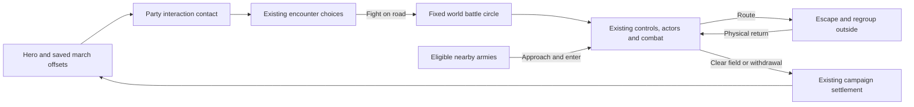

# World-map battles

Status: first playable campaign version, 2026-10-24. Enabled by `WORLD_BATTLE.on` in `prototype/js/battle/worldbattle.js`. Small colored figures stand in for travel soldiers; combat keeps the existing unit sprites, actors, orders, morale and campaign settlement.

## Travel and contact

The hero anchors the player's army. Army → Roster → March formation opens a drag editor, with group buttons and arrow controls for touch and keyboard use. The hero stays at zero. Apply stores offsets under `P.army.march`, keyed by persistent group ID; Back discards edits. Missing offsets use a ring round the hero. Wounded and away companions do not march as fit groups. Existing saves need no new world save piece.

The inner ring marks the core. Groups can stand anywhere inside the outer ring, including inside the core. Their entire formation footprint must fit; the interaction band outside it accepts no placement. The outer radius grows when a group's existing frontage/formation needs more room. Travel offsets rotate with the army's direction of movement. This first version keeps travel groups attached to the hero; individual travel pathfinding is not simulated.

Party contact uses both armies' outer radii plus their interaction bands. It opens the existing encounter window. Holdings and other non-party objects retain their normal interaction reach. Fight enters world combat for bands, lords, patrols, caravans, monsters and battles the player joins. Tournaments, assaults, raids, camps, caves and the Battle Lab retain their existing setup. Autoresolve remains available.

## Fixed battle area

The initial circle encloses the two starting parties' formation circles at their actual world positions. Its centre and radius stay fixed. Hero movement and reinforcements cannot move or enlarge it. A small apron outside the boundary allows escape and regrouping.

The battle uses local combat coordinates with a reversible world transform. Its ground is a sharp crop of `WorldArt`, with the real placed buildings. The movement/sight grid samples this same window of `WM`: terrain kinds, climates, elevation, roads, water, cliff edges and building footprints. It does not generate or mirror an arena. This first grid is coarse: it follows world tiles, rather than every painted tree or rock pixel. Specialized generated bridge/ambush layouts are replaced by the actual world terrain on these road battles.

The whole-field camera fits the circle between the HUD controls and order cards, including on landscape phones. Normal selection, move, dragged line, attack, abilities, AI control, zoom, pause and touch commands remain the battle engine's. Group destinations, waypoints and ordinary soldiers are constrained to the circle. Withdrawal uses the normal disengagement and stamina rules, with a circular exit. Saving during combat remains unavailable.

## Reinforcements and routing

Eligible lords, patrols, companions' parties and bandit bands can approach during combat. Existing relation/help rules choose a side; bands can help another band. Reinforcements enter from their world position when they physically reach the circle. Allies listed in the encounter also approach, rather than appearing immediately. Their existing actors activate once; later arrivals receive unique actor/group IDs and retain source-army and source-group identity. Troop casualties go back to those sources. Armies that never arrive receive no battle spoils or capture/relationship outcomes.

Routing soldiers may cross the boundary. They run into the apron, wait to regroup, then physically return. Health, ammunition and spent fatigue survive the trip. The group recovers enough morale to accept orders again. Explicit withdrawal does not cause an automatic return. A clear-field interval allows returns and arrivals before victory; new fighting cancels the countdown. Once the interval expires, the normal campaign report resolves the fight. The surviving hero's actual position becomes the travel anchor afterward.

Campaign calendar time and unrelated world simulation remain paused during combat, as in the previous battle mode. The arriving armies advance on combat time. Simultaneous independent tactical battles and a continuously advancing campaign are later work.

## Owners and tuning

| File | Responsibility |
| --- | --- |
| `prototype/js/battle/worldbattle.js` | `marchRows`, formation footprint/radius, direction, mock drawing; `WorldBattleArea` coordinates, terrain, boundary, arrivals, regrouping and cleanup; `WorldBattleSetup` |
| `prototype/js/ui/march.js` | Formation editor, draft/apply/back and touch dragging |
| `prototype/js/battle/setup.js` | Chooses world or existing battle setup |
| `prototype/js/battle/battlecontrol.js` | Normal order destinations constrained immediately, including while paused |
| `prototype/js/battle/battle.js` | World-area tick, final bounds and clear-field result check |
| `prototype/js/battle/morale.js` | Routing escape hook and circular withdrawal exit |
| `prototype/js/battle/resolution.js` | World-area cleanup before existing campaign settlement |
| `prototype/js/gfx/render.js`, `battle/camera.js` | World ground/boundary and minimap inside the existing battle renderer |
| `prototype/js/world/brains.js`, `world/world.js` | Party contact range |
| `prototype/js/world/parties.js`, `gfx/render.js` | Small travel formations |

`WORLD_BATTLE` owns the numbers: scale 6 combat pixels per world pixel; inner radius 18, minimum outer radius 38, interaction band 8, escape apron 22; approach speed 9 world pixels per combat second, reinforcement search 220 past the boundary; regroup wait 7 combat seconds, clear-field interval 16. Formation footprint can grow the outer radius. No new Systems/Saves registry entries are required.

## Verification

`worldbattle` covers formation bounds/drafts, contact, world coordinates, orders while paused, escape/return without restored vitals, dynamic arrivals, source casualties, withdrawal, non-arrival cleanup, saving/loading and heading. `worldbattleplay` runs complete campaign combat with physics, sight, AI, an approaching ally and normal results. `visual/worldbattle` supplies desktop and landscape phone travel, editor, combat and reinforcement scenes. Older fixtures explicitly disable `WORLD_BATTLE`, preserving their isolated battle behavior and fingerprints.
