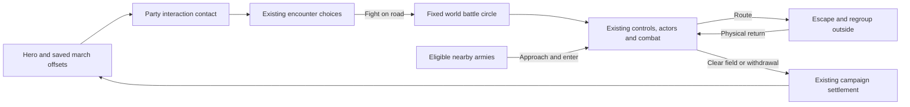

# World-map battles

Status: playable campaign version, with physical travel formations, individual pathfinding and actual-position battle entry, 2026-10-24. Enabled by `WORLD_BATTLE.on` in `prototype/js/battle/worldbattle.js`. Travel soldiers use the battle unit sprites, equipment and distance-driven walking poses at the same world scale, with faction cloth colors and individual troop races. Campaign leader sprites use their declared race; battle-side palettes remain unchanged; combat keeps the existing unit sprites, actors, orders, morale and campaign settlement.

## Travel and contact

The hero anchors the player's army. Army → Roster → March formation opens a drag editor, with group buttons and arrow controls for touch and keyboard use. The hero stays at zero. Apply stores offsets under `P.army.march`, keyed by persistent group ID; Back discards edits. Missing offsets use a ring round the hero. Wounded and away companions do not march as fit groups. Existing saves need no new world save piece.

The inner ring marks the core. Groups can stand anywhere inside the outer ring, including inside the core. Their entire formation footprint must fit; the interaction band outside it accepts no placement. The outer radius grows when a group's existing frontage/formation needs more room. Travel offsets rotate toward the army's movement heading at a bounded angular speed, including while it finishes a turn. Each visible military party has a faction-colored outer circle and a faint dashed interaction ring; your camp retains its army circle.

Each travel soldier owns a persistent runtime position and follows a goal from its group's saved offset and formation slots. Soldiers route around water, peaks, closed crossings and building feet; open ferries allow only their designated corridor. Narrow passages compress the ranks, with local avoidance and unique reachable goals. Soldiers reform on open ground and after the hero stops. The hero retains normal travel control; followers can catch up at 1.8 times the army's pace. Nearby military NPC armies use the same system. Drawing and pause never advance the soldiers.

`MarchGround` builds a bounded local 4-pixel grid and reuses the shared A* and flood helpers. Routes are cached, with at most six oldest-first path requests per army per update. Grids refresh after two world seconds, a route-version change or movement beyond their bounds. Armies update within sight range plus 180 world pixels. Runtime positions and routes reset on load, a new session or a large scripted relocation; saved group offsets are unchanged and need no migration.

Party contact uses both armies' outer radii plus their interaction bands. It opens the existing encounter window. Holdings and other non-party objects retain their normal interaction reach. Fight enters world combat for bands, lords, patrols, caravans, monsters and battles the player joins. Tournaments, assaults, raids, camps, caves and the Battle Lab retain their existing setup. Autoresolve remains available.

## Fixed battle area

The initial circle encloses the two starting parties' formation circles and their actual marching soldiers. Its centre and radius stay fixed. Hero movement and reinforcements cannot move or enlarge it. A small apron outside the boundary allows escape and regrouping. Tracked soldiers enter combat at their actual travel positions; surviving soldiers resume travel where combat leaves them.

The battle uses local combat coordinates with a reversible world transform. Combat draws over the live world renderer, with its surrounding terrain, buildings and minimap. The combat circle and escape apron have no fog or tactical concealment for either side; ordinary campaign fog remains outside. This temporary visibility does not explore or save unseen campaign land. Physical obstacles and projectile line of sight still apply. The native world canvas, map zoom and camera position stay unchanged when dialogue becomes combat; no arena fit, map switch or battle loading screen occurs. Campaign figures of participating armies are suppressed while their combat actors occupy those same world coordinates. The movement/sight grid samples this same window of `WM`: terrain kinds, climates, elevation, roads, water, cliff edges and building footprints. It does not generate or mirror an arena. This first grid is coarse: it follows world tiles, rather than every painted tree or rock pixel. Specialized generated bridge/ambush layouts are replaced by the actual world terrain on these road battles.

Combat sprites and formation spacing are three times their original size, including fallen bodies, selection bounds and line previews. March footprints account for the wider ranks. Moving combat figures snap to native display pixels rather than whole world pixels; their walk poses follow distance travelled. Group markers retain a stable screen size at the world canvas scale. The world camera can still pan; there is no separate battle zoom or automatic fit. Ordinary route grids are masked to the circle, with separate unmasked grids for escape into the apron. Normal selection, move, dragged line, attack, abilities, AI control, zoom, pause and touch commands remain the battle engine's. Group destinations, waypoints and ordinary soldiers are constrained to the circle. Withdrawal uses the normal disengagement and stamina rules, with a circular exit. Saving during combat remains unavailable.

## Reinforcements and routing

Eligible lords, patrols, companions' parties and bandit bands can approach during combat. Existing relation/help rules choose a side; bands can help another band. Reinforcements enter from their world position when they physically reach the circle. Each tracked rear marcher must cross the boundary before its combat actor activates; its goal moves inside the fixed circle without teleporting it. Allies listed in the encounter also approach, rather than appearing immediately. Their existing actors activate once; later arrivals receive unique actor/group IDs and retain source-army and source-group identity. Troop casualties go back to those sources. Armies that never arrive receive no battle spoils or capture/relationship outcomes.

Routing soldiers may cross the boundary. Each chooses a fixed, reachable exit on the unmasked terrain grid, follows its path around rock/cliffs, and leaves as soon as it crosses the boundary. It may wait in the apron to regroup, then physically return while allies continue fighting. Health, ammunition and spent fatigue survive the trip. The group recovers enough morale to accept orders again. Each group gets one return by default; another rout leaves permanently, preventing endless escape/rejoin cycles. Explicit withdrawal does not cause an automatic return. When either side has no fighters left, victory or defeat is final; the normal result banner lasts two speed-adjusted seconds before campaign settlement. There is no clear-field delay in which a fully routed side can rally and restart the fight. Regrouping and approaching reinforcements cannot reopen a decided outcome. After 30 combat seconds without damage, a battle where neither side has a legal route or an unobstructed attack in range ends as Disengaged. This does not award victory, charge a retreat renown/gold penalty, or force a rematch. Connected armies that the player orders to hold are not timed out. The surviving hero's actual position becomes the travel anchor afterward.

Campaign calendar time and unrelated world simulation remain paused during combat, as in the previous battle mode. World battles inherit and share `G.speed` (1×, 2×, 4×, 8×), including the buttons, bracket keys and speed retained on return to travel. Movement uses the campaign pace and `WORLD_SCALE.move`, converted to local combat coordinates; hero and troops use that same clock. Scaled updates are split into steps of at most 1/60 second before pace conversion. Hero hit-stop and charge slow motion do not freeze or slow every army in world combat. The arriving armies use their normal `partySpeed`, converted from combat coordinates to world distance on this clock. Simultaneous independent tactical battles and a continuously advancing campaign are later work.

## Owners and tuning

| File | Responsibility |
| --- | --- |
| `prototype/js/world/march.js` | `marchRows`, footprint/radius, direction, mock drawing; `MarchGround` routes and shared building feet; `MarchArmy` physical soldiers, formation goals and avoidance |
| `prototype/js/battle/worldbattle.js` | `WorldBattleArea` coordinates, terrain, boundary, actual-position handoff, arrivals, regrouping and cleanup; `WorldBattleSetup` |
| `prototype/js/core/session.js` | Clears the player's runtime march state on reset |
| `prototype/js/ui/march.js` | Formation editor, draft/apply/back and touch dragging |
| `prototype/js/battle/setup.js` | Chooses world or existing battle setup |
| `prototype/js/battle/battlecontrol.js` | Normal order destinations constrained immediately, including while paused |
| `prototype/js/battle/battle.js` | Shared-speed substeps, matching hero/troop time, world-area tick, bounds and terminal results |
| `prototype/js/battle/morale.js` | Routing escape hook and circular withdrawal exit |
| `prototype/js/battle/formations.js`, `commands.js` | Scaled formation slots, dragged-line preview and sprite picking |
| `prototype/js/battle/terrain.js` | World combat bypasses tactical concealment, preserving collision and projectile sight lines |
| `prototype/js/ui/ui.js` | Shared world battle speed buttons and bracket steps |
| `prototype/js/gfx/sprites.js`, `vfx.js` | Distance-based walk poses and matching fallen-body scale |
| `prototype/js/battle/resolution.js` | World-area cleanup before existing campaign settlement |
| `prototype/js/gfx/render.js`, `battle/camera.js` | World ground/boundary and minimap inside the existing battle renderer |
| `prototype/js/world/brains.js`, `world/world.js` | Party contact range |
| `prototype/js/world/parties.js`, `gfx/render.js` | Small travel formations |

`WORLD_BATTLE` owns the combat numbers: scale 6 combat pixels per world pixel; inner radius 18, minimum outer radius 38, interaction band 8, escape apron 22; reinforcement search 220 past the boundary (approach uses normal party speed); regroup wait 7 combat seconds; sprite/formation scale 3 and maximum scaled real-time step 1/60 second; at most 1 regrouped return per group and terrain-stalemate quiet interval 30. Formation footprint can grow the outer radius.

`MARCH_MOVE` in `world/march.js` owns travel tuning: grid cell 4, padding 48, chunk 64, repath delay 0.45 seconds, refresh 2 world seconds, catch-up multiplier 1.8, turn speed 3.5 radians/second, personal gap 2.4, active margin 180, path-query budget 6 and relocation reset distance 160. The `march formations` frame system runs at order 145, before arrival. No new save piece is required.

## Verification

`marchpaths` checks independent legal positions, bridges and ferries, building detours, turns and reversals, reforming, bounded path requests, recruits/losses, pause, session reset, NPC armies and actual-position battle handoff. `visual/marchpaths` supplies desktop and landscape-phone bridge, reformed-rank and 150-soldier scenes.

`worldbattle` covers formation bounds/drafts, contact, world coordinates, orders while paused, escape/return without restored vitals, dynamic arrivals, source casualties, withdrawal, non-arrival cleanup, saving/loading and heading. `worldbattleedges` checks circles, the shared world viewport/minimap, final routing, circular route grids and neutral disengagement. `worldbattleissues` covers real damage-to-victory/defeat settlement, full rout, a radial exit blocked by rock, collision-safe escape, formation spacing, native pixel movement, sprite scale, shared speed, matching hero/troop timing, pause and local fog clipping without exploration leaks. `worldbattleterrain` runs on untouched generated roads, forests and hills. `worldbattleplay` runs complete campaign combat with physics, sight, AI, an approaching ally and normal results. `visual/worldbattle` supplies desktop and landscape phone travel, editor, combat and reinforcement scenes. Older fixtures explicitly disable `WORLD_BATTLE`, preserving their isolated battle behavior and fingerprints.
